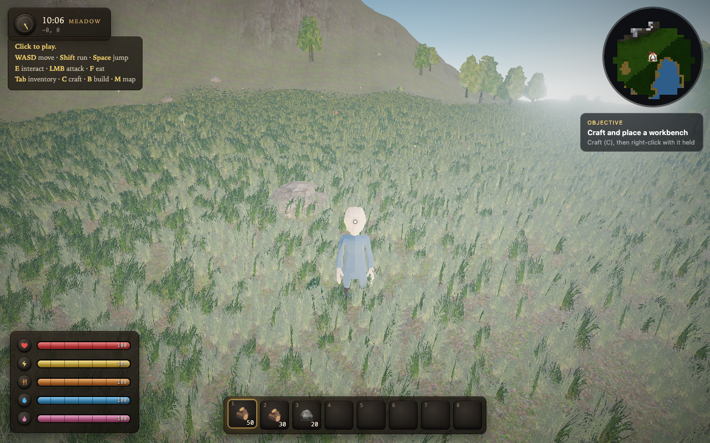
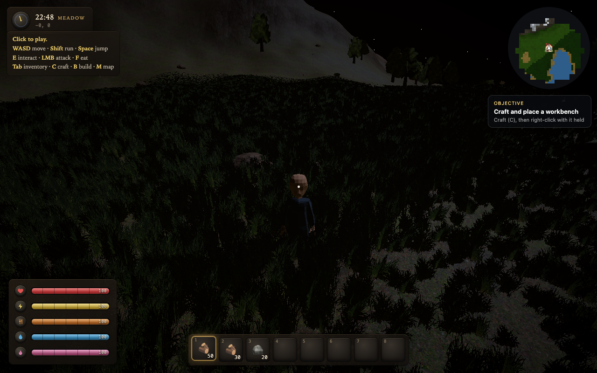
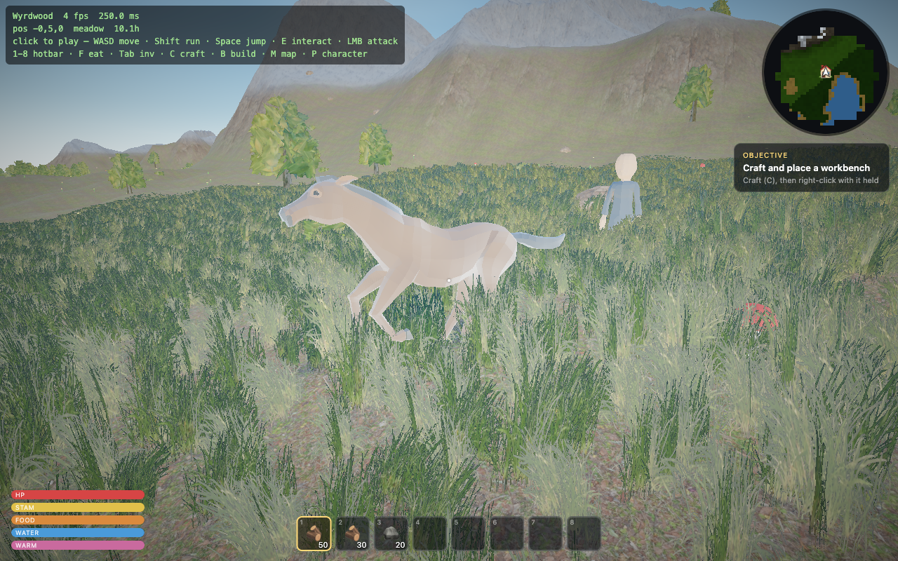

# Wyrdwood

A 3D survival-crafting game — gather, craft, build, survive, and follow the
objective chain to a goal. Runs in the browser during development and ships as a
native desktop app via Electron.

Built with **Three.js**, **TypeScript** and **Rapier** physics, rendered with
photoscanned PBR terrain, image-based lighting from a live atmospheric sky, and
rigged, animated wildlife.



---

## Quick start

```bash
npm install          # first time only
npm run assets       # download the CC0 art kit (~41 MB) into public/assets
npm run dev          # dev server → http://localhost:5173  (open in Chrome)
```

Add `?dev` to the URL to skip the menus and drop straight into a world with
starting materials.

| Command | What it does |
|---|---|
| `npm run dev` | Vite dev server with hot reload |
| `npm run assets` | Fetch the CC0 texture + model kit into `public/assets` |
| `npm run app` | Build and launch the Electron desktop app |
| `npm run electron:dev` | Electron window pointed at a running dev server |
| `npm run dist:mac` / `dist:win` | Package a distributable `.dmg` / `.exe` into `release/` |
| `npm run build` | Typecheck + production build into `dist/` |
| `npm run typecheck` | `tsc --noEmit` (strict) |

## Controls

**WASD** move · **Shift** run · **Space** jump · **E** interact/harvest ·
**LMB** attack · **RMB** place held · **1–8** hotbar · **F** eat · **Tab** inventory ·
**C** craft · **B** build · **M** map · **P** character · **F1** toggle HUD ·
**F3** performance · **Esc** pause

All of these are rebindable in **Settings → Keybinds**.

---

## Screenshots

| | |
|---|---|
|  |  |
| **Night** — moonlit, dark but navigable | **Wildlife** — rigged, with real gaits |

---

## Documentation

- **[SPECS.md](SPECS.md)** — minimum / recommended / ultra hardware, and exactly what
  each graphics preset changes.
- **[USER_GUIDE.md](USER_GUIDE.md)** — installing, launching, and how to play.
- **[CLAUDE.md](CLAUDE.md)** — architecture, conventions, the asset pipeline, and the
  rendering rules that are easy to get wrong (tone mapping, post-processing order, the
  sky's environment map).

---

## How it looks the way it does

Almost nothing on screen is a flat colour. The visuals are built on **real CC0 assets**,
fetched by `scripts/fetch-assets.mjs`:

- **Terrain** is a four-layer PBR splat (grass / rock / sand / snow) blended from
  per-vertex weights, using photoscanned albedo, normal and roughness maps
  ([Poly Haven](https://polyhaven.com)).
- **Vegetation** uses those scans as *textures* on game-ready geometry. Poly Haven's tree
  models are photogrammetry — one pine's mesh alone is a 950 MB `.bin` — so instead:
  trunks are tapered cylinders wearing scanned bark, canopies are shells of alpha-cut
  leaf-cluster cards, and grass is photographic billboards planted densely enough to
  close into a real carpet.
- **Creatures** are rigged, skinned glTF models with real animation clips
  ([Quaternius](https://quaternius.com)). Primitives never read as animals — gait matters
  as much as anatomy.
- **Lighting** is image-based: the live atmospheric sky (with volumetric clouds) is baked
  into an environment map whenever the sun moves, so ambient light is warm near the sun
  and cool opposite it. It's tone-mapped with **AgX**, so a bright sky rolls off instead
  of clipping to white.

All bundled art is **CC0** — public domain, redistributable, no attribution required —
so it is committed and ships inside the app.

## Tech

Three.js (WebGL2) · TypeScript (strict) · Vite · Rapier (WASM physics) ·
simplex-noise · Electron. Saves and settings live in `localStorage`; no backend.
